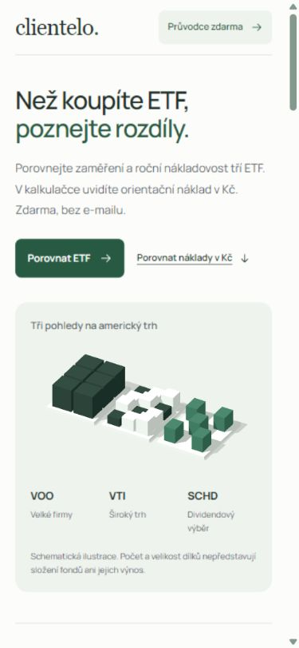
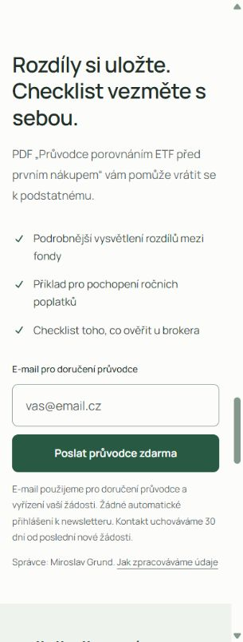

# Závěrečná kontrola — bod 11

Provedeno 15. 10. 2026 na veřejném webu https://etf-gold.vercel.app/ a zdrojovém stavu `a82d6a8`. Níže uvedená dokumentace a exporty vznikly následně; aplikační kód se při této kontrole neměnil.

| Oblast | Provedená kontrola a výsledek |
| --- | --- |
| GitHub a nasazení | GitHub API: Myro685/ETF, private=false, hlavní větev main. `git ls-remote` potvrdil publikovanou větev. Veřejná stránka funguje bez přihlášení. |
| Automatické kontroly | Všech 23 testů prošlo, lint a produkční build prošly. Testy pokrývají výpočty, formulář, HTTP, Gmail OAuth, idempotenci a souběh, databázové migrace, měření a kompilaci Vercel API. |
| Mobilní rozložení | V prohlížeči ověřené šířky 320, 390, 768 a 1440 px. Dokument ani tělo nepřesahují dostupnou šířku. Vizuálně zkontrolovaný úvod při 390 px, formulář při 390 a 320 px a srovnávací tabulka na úzkém i desktopovém zobrazení. Dočasné nastavení viewportu po testu zrušené. |
| Navigace | Všech 12 nalezených interních odkazů míří na existující ID. Kliknutí na nabídku průvodce a rozbalení zdrojů ověřené v živém prohlížeči. |
| Externí zdroje | Všech devět jedinečných HTTPS zdrojů z etfs.json vrátilo při GET HTTP 200: dva fact sheety Vanguard, SEC dodatek, Schwab, NYSE, ČNB, IBKR a dva odkazy Fio. Kontrola dostupnosti neznamená nové ověření všech údajů ve fondech. |
| Kalkulačka | Živý vstup 200 000 Kč zobrazil 60 Kč pro VOO, 60 Kč pro VTI a 120 Kč pro SCHD; rozdíl 60 Kč. Automatické testy navíc pokrývají formát, hranice a chyby. |
| Kvíz | Živě ověřená odpověď na první otázku se správným vysvětlením a možností pokračovat. Všechna skóre a kombinace odpovědí ověřené automaticky. |
| Živý formulář | Prázdné upravitelné pole, správce, účel, uchování a informační odkaz. Neplatný vstup zobrazil českou chybu a vrátil fokus na pole. Tento pokus neposlal e-mail. |
| Stavy formuláře v prohlížeči | Lokální tests/form-preview.html s podvrženou službou: čekání, úspěch, chyba doručení, výpadek sítě, nejisté přijetí a nedostupná konfigurace. Při čekání je tlačítko disabled, dva další Entery ponechaly počet žádostí 1. Úspěch zobrazil potvrzení a odkaz. Nejistý výsledek blokuje opakování. Bez konfigurace počet odeslání 0. Žádný skutečný mail ani kontakt z těchto scénářů nevznikl. |
| Doručení obsahu | Již provedený skutečný koncový test 15. 10. uživatel potvrdil: potvrzení na stránce, e-mail a otevřené PDF. Zápis a přijetí Gmailem byly samostatně ověřené. Kvůli této závěrečné kontrole se další zpráva neposílala. Obě veřejné kopie PDF (Vercel i Supabase) dostupné HTTP 200/application/pdf. |
| Měření | Nově ověřený skutečný produkční zápis pro A/B, použití kalkulačky a kvízu, CTA a zahájení formuláře. Server zachoval první reklamu i po změně varianty v dalším požadavku, opakování nezvýšilo počet. Neexistující žádost vrátila 409 bez konverze, nadbytečná vlastnost email 400. Dříve ověřené skutečné form_success a contact_acquired stále přítomné. Nové kontrolní relace uložené do soukromého vylučovacího seznamu. Souhlas a jeho odmítnutí/odvolání ověřené v bodu 8 a automaticky. |
| Informace a API | Kořen webu, aktuální informace, archiv dema a /api/guide-config vrátily HTTP 200. API nezveřejňuje klíče. |
| Audit údajů | 44 dosažitelných commitů, 472 historických blobů, pracovní soubory včetně exportů a 13 sestavených souborů. Kontrola přesných hodnot aktuálních tří aplikačních tajemství, vzorů tokenů/JWT/soukromých klíčů a e-mailových řetězců. Bez nálezů aplikačních klíčů nebo kontaktů návštěvníků. Adresy v testech a zdrojových skillech ručně rozlišené jako fixtures/metadata; zveřejněná kontaktní adresa správce je autorizovaná. |

## Opakování

```powershell
npm test
npm run lint
npm run build
python scripts/audit-repository.py
npm run report:measurement
```

Audit zapisuje soukromý výsledek do ignorovaného `private-data/repository-audit.json`; žádné hodnoty klíčů ani adres nevypisuje. Zahrnuje všechny dosažitelné Git refs pomocí `git rev-list --objects --all`, nikoli smazané nedosažitelné objekty, vzdálené platformní logy nebo jiné počítače. Kombinace přesných známých hodnot a vzorů není matematický důkaz nepřítomnosti všech neznámých tajemství. Veřejný export dialogu má vlastní redakční postup a manifest v ai-log/exports.

## Praktická omezení

Kontrola viewportu není test na fyzickém telefonu; úplný screen reader audit ani mobilní LCP na skutečné síti nebyly měřené. Build upozorňuje na oddělený 3D chunk kolem 530 kB. Příjem e-mailu v každé schránce nelze zaručit jen přijetím Gmailem. Konverze nemá zatím vyhodnocený obchodní vzorek, placená kampaň neběží. Doložení smluvních a provozních podmínek poskytovatelů pro ostrý veřejný provoz zůstává podle privacy-operations.md otevřené. Bod 11 uzavírá ověřené nasazení a testování v rozsahu zadání, tato omezení nevymazává.

## Snímky

Mobilní úvod a úzký formulář jsou uložené v `docs/qa-assets`. Snímky zobrazují veřejný web bez kontaktů návštěvníků. Nejsou náhradou výše uvedených testů.




